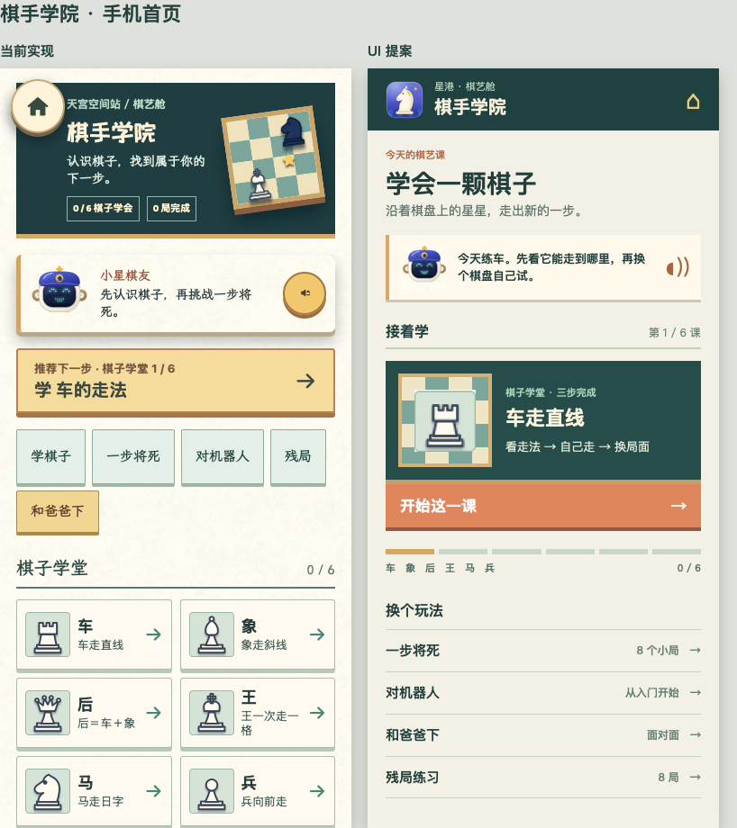
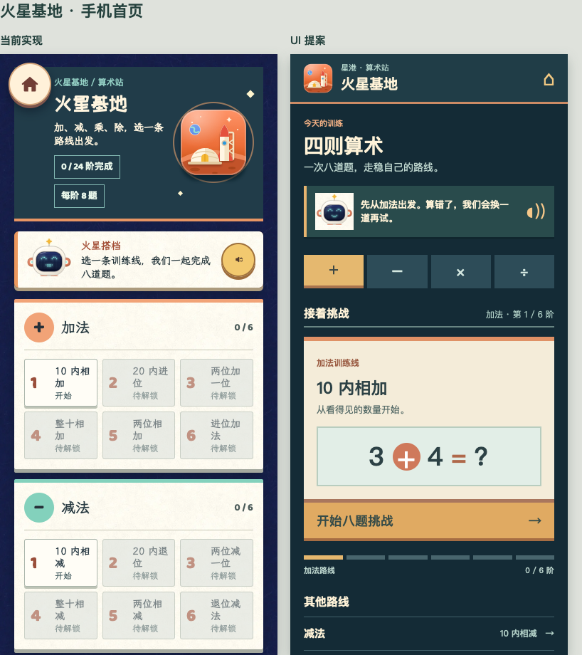

# 学习入口 UI 对比

这两组图以 390 × 844 手机视口制作。左侧是本地现行游戏截图；右侧是布局提案，尚未接入游戏。棋盘、机器人和游戏图标沿用现有素材，便于比较信息组织本身。

## 主要变化

- 棋手学院：首屏聚焦下一堂课，课程进度和其他玩法向下展开。现有的课程、一步将死、机器人、双人和残局都保留。
- 火星基地：先选运算路线，再显示当前可玩的下一阶；已解锁的其余关卡可在路线内展开。错题复练属于本轮功能改动，与这份首页布局提案独立。
- 这版提案只演示首页层级。机器人配音、棋盘操作、关卡页面和 iPad 横屏布局未做视觉改造，不能据此判断整款游戏的最终观感。

本轮代码没有采用右侧提案；只有棋手学院增加了一个“推荐下一步”入口，用于降低首次选择负担。
