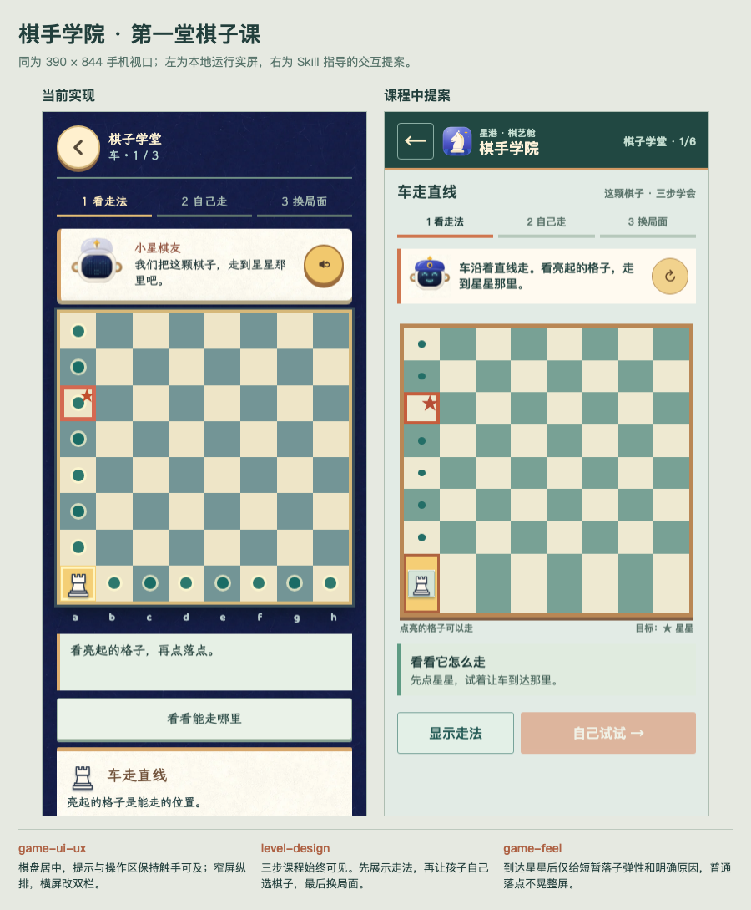
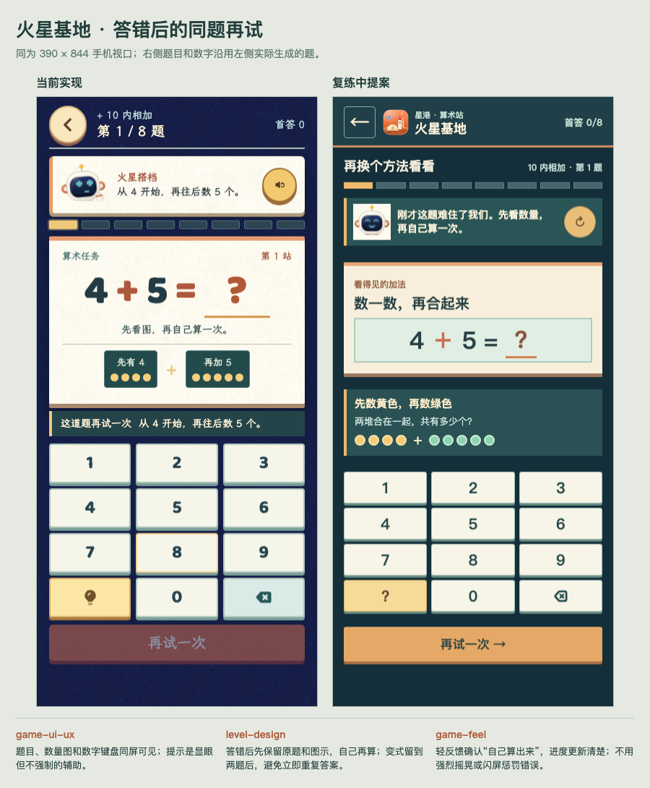

# 学习中交互方案对比

左侧是本地游戏实际运行的 390 × 844 手机截图；右侧是应用 `game-ui-ux`、`level-design`、`game-feel` 后的交互提案。两者都展示游戏中的一屏，而不是首页。提案尚未接入正式游戏。

## 三份 Skill 如何进入方案

| Skill | 棋手学院 | 火星基地 |
| --- | --- | --- |
| `game-ui-ux` | 棋盘、目标、提示和下一步操作在手机同屏；横屏转为棋盘与指导双栏，操作区留在可见范围。 | 题目、数量图和数字键盘保持同屏；辅助提示易找，首答成绩与题号清楚。 |
| `level-design` | 课程一直显示“看走法 → 自己走 → 换局面”，第二步需要孩子亲自选棋子再落子。 | 先保留原题和数量图让孩子再算，变式在两题后出现，避免立即背答案。 |
| `game-feel` | 正确落子时棋子短暂弹入、原因文字平稳出现；普通操作没有整屏抖动。 | 答对后的数字与解释短暂弹入；答错时给安静的图示帮助，不用强闪或惩罚动画。 |

反馈后一帧：[棋手学院](skill-chess-success.png) · [火星基地](skill-mars-success.png)。横屏布局：[棋手学院](skill-chess-landscape.png) · [火星基地](skill-mars-landscape.png)。

[交互提案源文件](skill-flow-proposal.html) 可本地打开。追加 `?game=mars` 切换至火星基地。原型只模拟这两段教学交互，不替代游戏规则、配音和完整关卡。原型中的“再听一遍”展示按钮位置，不会播放声音。
